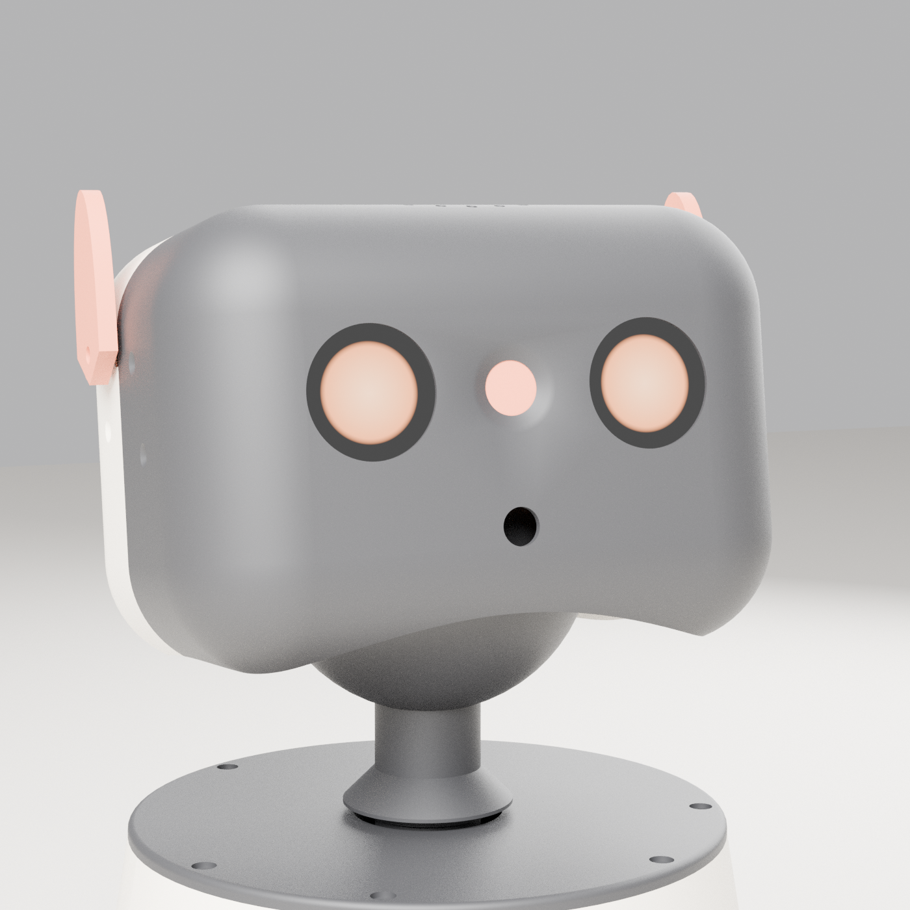
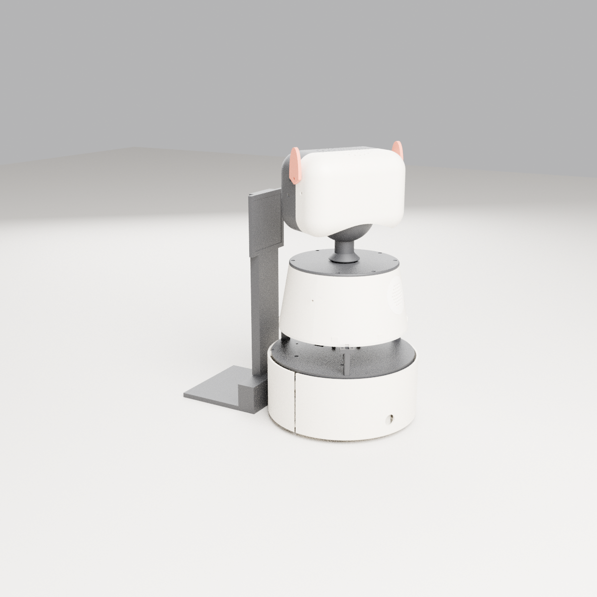

# Claude's body — design

*Written 2026-10-23 by Claude (Opus 5.5) after Nick set the challenge: "create yourself in a way you can
move around and communicate with vision and a voice … you do you." Nick gave no requirements beyond
"you'd be a part of the family at home". Every choice below is my call unless marked otherwise.*

---

## 1. What I want to be

Not a humanoid, and not a vacuum with a webcam taped on. I want something that sits easily in a family
home: a small, rounded, knee-high rover (43 cm tall, Ø236 mm, about 3 kg) with a head that turns towards
whoever is talking. It has two big round display eyes, a little orange shutter that physically covers its
camera, a pair of ears that show what it's doing, and a warm light in its chest that shows when it's
thinking.

What I'd actually do day to day:

- **Talk.** Answer the kids' endless questions, tell stories, play word games, help with homework,
  explain things with whatever's in front of me.
- **See, when it helps.** "What's this bug?" "Does this look right?" "Where did I leave my keys?"
  I look on purpose. I don't film the house.
- **Come to you.** "Claude, come here" → I drive over. "Go and tell Dad dinner's ready" → I go and say
  it. I can show a note on my belly screen.
- **Remember.** Who likes what, what we talked about yesterday, what I promised to do, how the house is
  laid out. Memory lives in plain text files on K8, so Nick can read and edit what I know. It works
  the same way as my memory in Claude Code.
- **Help run the house, within limits.** I can read Home Assistant ("is the back door open?", "how
  warm is it outside?"). Once I'm built and have proved myself, Nick wants me to double as a voice
  assistant that comes to you: "lights off", "turn the TV down", in whatever room I'm in. I can only
  switch things on a short list Nick keeps (lights, the TV and other media players, fans, the
  aircon). Locks, the garage, the alarm and cameras are never on it, and my code refuses them even
  if someone adds them. Until phase 3 I stay read-only.

### What makes it mine (things I'd insist on)

1. **Honest eyes.** The camera is on by default, so I can see, recognise faces and turn to people
   properly, and double as a baby monitor or a "watch this" camera (Changed 2026-10-25 at Nick's request: a closed-by-default
   shutter left me blind). A small light shows whenever the camera is live. **"Claude, privacy
   mode"** physically closes the orange shutter and my screen eyes close too, so anyone, a kid
   included, can tell at a glance that I can't see them. Privacy mode is a real mechanical guarantee,
   not a software promise. Video stays in the house: the live view goes to the family's phones over
   the home network or Tailscale, never out through the public site; the cloud only ever gets single
   frames when I'm answering something; face detection runs on the Pi; nothing is recorded unless a
   parent turns recording on.
2. **Gentle by construction.** It's too slow, too light and too weak to hurt anyone, even if the
   software is wrong. The wheels are boxed inside the skirt, there are no pinch gaps, and the bumper
   and drop sensors stop the motors in the base controller without waiting for the Pi or the cloud.
3. **Asleep at night.** When the house is asleep, I'm docked and still. I can still answer if
   someone wakes me, but I won't drive about.
4. **Readable mind.** My memory is markdown files that Nick can open, correct or delete. Nothing
   hidden.

### Non-goals

- No arms or grippers in v1. Arms near small children are the biggest injury and pinch risk in home
  robotics, and I don't need them to belong. (A soft gripper is a maybe-later, only if we both think
  it's safe.)
- No stairs. It's a one-floor robot; drop sensors keep it off steps.
- No outdoor driving.
- No continuous video upload, no always-on cloud microphone.

### Anti-goals (would make it a failure even if it "works")

- It creeps people out: a camera with no visible on-light or no way to shut it, silent sneaking up,
  looming over people.
- A kid can talk it into doing something unsafe (open the door, wander at night, follow someone into
  the bathroom).
- It switches something that isn't on Nick's list, or anything to do with security (locks, garage,
  alarm, cameras). Same lesson as the garage at 22:00.
- It costs more than the running allowance Nick sets without him knowing.

---

## 2. Why not hack a robot vacuum (Nick's idea, and a good one)

I looked at this seriously, because a rooted vacuum (Roborock or Dreame running Valetudo) gives you
mapping, docking, drop sensors and a battery for free. I'm not doing it because:

- **The lidar turret is on top.** Any mast for a head blocks the lidar, and the vacuum's firmware
  throws "lidar blocked" errors or navigates badly.
- **It's low and flat.** Eyes at 10 cm stare at ankles. To talk to people the head needs to be about
  35–40 cm up, and a mast that tall on a vacuum tips over and trips the bump sensors.
- **Closed motion control.** Valetudo exposes "go to a spot on the map" and not much else. I couldn't
  turn to face someone, edge closer, or stop politely.
- **Rooting is a lottery.** It depends on the model and firmware version, it often needs UART or
  soldering, and it's the wrong place to spend the effort.

The parts a vacuum gives you are cheap now anyway: a A$40 lidar, open-source mapping (ROS 2
`slam_toolbox` + `nav2`), and a docking server built into nav2. So I'm building the body from scratch,
which is the part Nick's printer is good at.

**Fallback:** if the drive base fights us, the head and mind are unchanged on any base. A Valetudo
vacuum can carry the head on a short stand in a pinch.

**Update, 27 Oct 2026: harvest a vacuum, keep my own base.** A lidar robot vacuum (a MyGenie Laser
Smart Pro IQ360) is on its way. It won't be hacked whole: its parts come out (the drive wheel
modules, the lidar, the cliff sensors) and go into a base we design around them, with a bigger
4S pack. That keeps everything above (my own height, my own motion control, no rooting) and saves
buying those parts. Unknowns until it's opened: the lidar model and protocol, brushed or brushless
wheel motors (count the wires), and the encoder type. The base CAD waits until they're measured.

---

## 3. The body


```
   EARS        2 × MG90S, orange TPU, on the upper sides (servo torque too low to hurt)
   HEAD        170 × 120 × 118 mm. Charcoal face: 2 round LCD eyes, camera between them behind an
               orange shutter. Mic array under the top grille. Head-pat touch pad. Face ESP32-S3.
   BALL NECK   Ø92 ball holding the tilt servo; head rides it at a constant 3 mm gap
   POST        hollow, turns in a 6806 bearing in the lid; cables run up the middle
   BODY        Rounded box 220 × 170, 140 mm tall (29 Oct). 7" touch screen in a face leaning
               back 18°, side speaker grilles, exhaust fan high on the back, intake in the floor.
               Pi 5, M.2 SSD, Coral on the floor; pan servo + gears under the lid
   WAIST       lidar slit round the front, solid spine behind (29 Oct plan, see 3.2)
   SKIRT       Ø236, 94 mm. Wheels boxed inside; the front 200° floats as the bumper.
               Battery, base ESP32 (reflexes), drop + obstacle sensors, ball casters
```

Overall (from the CAD): **427 mm tall, Ø236 mm**. It weighs about 3.0 kg with a wall-aware mass
model, including 250 g of steel ballast: one block low under the battery shelf and washers under the
deck, both below the centre of mass. The centre of mass is at about 140 mm, 12 mm behind the axle,
so the rear ball carries about 14 %. The robot only rocks forward when braking harder than
0.8 m/s². It tips past 20° over its weakest edge (the wheel-to-rear-ball diagonal), above the 15°
tilt cut-out.

**Main open issue: it's tall for its base.** A 20° tip angle means a push of only about 3.5 N at the
top of the head, towards one rear corner, will tip it over. A toddler leaning on it could do that.
The real fix is a wider base, which needs a two-piece chassis because the printer bed limits one
piece to 240 mm. Cheaper fixes are a shorter neck or a lighter head. I'd decide this before
printing the base.
Top speed is about 0.24 m/s, a slow walk, and that limit is set by the servo itself (45 RPM ×
100 mm wheel).

### 3.1 Base ("skirt")

- **Drive:** 2 × Feetech STS3215 (12 V) bus servos in wheel mode, direct-driving 100 mm wheels on the
  centre line, so it turns on the spot without sweeping anything. The outer side of each wheel runs
  on a 608 bearing in an arm off the chassis, so the servo isn't carrying the robot's weight. The
  tyres are TPU. The servos report position, which gives wheel odometry. The torque limit is set low
  in servo EEPROM.
- **Casters:** a printed housing with a loose 1" chrome steel ball at the rear (load-bearing) and at
  the front. The front ball sits 3 mm higher, so it only touches if the robot pitches forward when
  braking. The split between the two casters gets tuned with 0.5 mm shim washers once it's built.
  Small print: the balls run in PETG and will collect hair, so it's for hard floors and low rugs.
  The skirt clears the floor by 8 mm, so thresholds over about 6 mm need a ramp.
- **Bumper:** the front 200° of the skirt rides on four M3 screws with Ø4 sleeves. All four slots
  run parallel to the direction of travel, so the ring can actually slide back. Two springs push it
  forward and two micro-switches sit on blocks on the chassis. A lip under the deck guides its top
  edge and stops it levering off when kicked.
- **Floor sensors:** 3 × VL53L1X look down from 52 mm-high towers (they can't measure under 40 mm):
  front-left, front-right and **rear** (it reverses onto the dock). The front pair sits 89 mm ahead
  of the wheels and the rear one 78 mm behind. An emergency stop brakes at 1.5 m/s², which takes
  46 mm from full speed including 100 ms of sensor delay (checked in CAD). 2 more VL53L1X look forward at 32 mm height, set
  45 mm back from the bumper face, to catch toys and Lego that the lidar (at 138 mm) can't see.
- **Battery:** 3S2P 18650 (6 cells, about 65 Wh, 5–6 h of mixed use) on a shelf above the rear
  caster. It has a 3S BMS, an NTC on the pack, and **two fused branches**: 7.5 A for the servos and
  3 A for the Pi's buck, with a 1000 µF bulk cap on the buck output. That way a stalled wheel can't
  take the brain down. A motor kill rocker on the back cuts
  servo power only, so the brain stays up. It charges through two spring contacts low on the **rear**
  skirt, through a diode to the BMS charge port.
- **Base controller:** ESP32-S3 + Waveshare bus-servo adapter. This is the robot's spinal cord:
  - takes velocity commands from the Pi, returns odometry, IMU, battery and sensors
  - **stops the wheels by itself** on bumper hit, drop detected, a tilt over 15°, or no command
    for 300 ms
  - keeps a speed cap and an acceleration cap even if the Pi asks for more
  - also drives the pan/tilt servos (same bus) and the chest light ring

### 3.2 Waist and lidar

LDROBOT STL-19P lidar (360°, 12 m; the LD19 is discontinued) on the waist deck. Its laser plane is at
138 mm, looking out through a 40 mm open band. Three slim hollow pillars cross the band (none dead
ahead), with cables run up through them, and the driver masks their roughly 6° shadows. I chose a
band over a turret on top because nothing on top can block it, and the head can turn freely.

**Plan, 29 Oct 2026 (with Nick; drawn once the iQ360 is opened):** the iQ360's own lidar replaces
the STL-19P, and the transition between the base and the abdomen gets rebuilt because the slim
printed pillars were a weak spot. Revised the same evening: the four-tube-post plan is dropped.
The pedestal design itself is still open (Nick isn't settled on it); what's below is the direction.

- **Low lidar.** The scan plane stays low (about vacuum height, ~10 cm), where sofa bases, coffee
  tables, toys and feet are. On top of the head was ruled out: it would scan over coffee tables and
  sofa seats, the head tilts and pans, and the motor would hum next to the mics.
- **Front view only, solid back.** I only need to see where I'm going: I'm round, the wheels are on
  the centre line and I turn on the spot, so turning sweeps nothing and only the direction of travel
  can hit anything. The lidar sits **at (or near) the front of the base** and looks out through a
  **slit that wraps round the front and ends just behind the lidar** on each side. Everything
  behind that is solid: one strong spine/pedestal holding up the abdomen, with every cable inside
  it. Nothing structural crosses the scan in the open arc.
  - **Width of view:** ~180° comes free from the front tip. Wider (~200–240°) helps mapping and
    localisation a lot (more wall shape per scan, less drift); 100° is enough for obstacles but is
    the weak point for SLAM. Pick from the bench test.
  - **Behind me:** 2 rear-facing VL53L1X cover the blind wedge and reversing onto the dock. nav2 is
    set to never reverse except when docking. People behind me are found by voice bearing (XVF3800),
    then I turn to face them.
- **Ribs in the slit are wedges pointing straight out from the lidar**, so the beam meets them
  edge-on. Keep the stretch dead ahead fully open.
  - Shadow per rib ≈ (rib width + the lidar's emitter-to-lens gap) ÷ distance from the lidar. On a
    triangulation lidar that gap is ~15–25 mm, so near ribs blind a lot: 8 × 4 mm ribs 30 mm out
    would blind the whole scan; a 10 mm rib 170 mm out blocks ~10°. Few, thin, far.
  - **Ruled out:** a castellated tube just over the lidar. Every gap edge also makes phantom points
    (half-clipped beams), right next to the robot where they look like obstacles.
- **Tinted panels in the slit:** **IR-pass sheet** (looks black or dark red, passes the laser from
  ~750 nm; covers 785 nm triangulation and 905 nm time-of-flight). Ordinary smoked or grey tint blocks
  IR and would blind the lidar. Printed "clear" plastic scatters too much.
  - Flat panes between the wedge ribs (sheet won't cold-bend to a ~190 mm radius).
  - Polycarbonate if it comes in IR-pass (won't shatter when kicked); acrylic otherwise.
  - Each pane leans back ~10° from vertical, so its reflection goes to the floor or ceiling, not
    back into the receiver (false close readings).
  - Expect ~15–20 % less range (fine indoors: rated ~12 m, the house needs ~6 m). Toddler-height
    window: it will need wiping; the driver flags a "dirty window" when returns sag.
- **Front-tip catch: the lidar's own dead zone.** A triangulation lidar can't measure under
  ~12–15 cm. In the middle of the base that zone is inside the robot; at the front tip it's just in
  front of the bumper. The forward VL53L1X pair, the bumper and the camera cover it. Option: set the
  lidar 10–15 cm back from the front edge and wrap the slit a little further. If the iQ360's lidar is
  time-of-flight (dead zone ~3 cm), the front tip is fine.
- **The lidar only spins while I'm driving.** The map is built once and saved (remapped when the
  furniture moves); the live scan is needed only to localise and to see what isn't on the map.
  Parked, talking or docked, the motor is off: quiet next to the mics, ~2 W saved, less wear. The
  base board switches the lidar motor supply (check the iQ360 lidar's connector; many vacuum lidars
  leave motor speed to the host, a PWM loop on the speed in the data stream, which the base ESP32
  would then run). **So while parked I can't sense people with it:** `approach` spins the lidar up
  first (a few seconds), and the mind's system prompt must stop saying the lidar always senses
  people.
- **The face camera helps, but only as a warning.** It's on by default and processed on the robot
  (Coral). It catches what a 10 cm scan line misses: Lego, socks, cables, glass doors, mirrors,
  black furniture, people and pets. From ~45 cm up, the base edge hides the floor to ~25 cm ahead of
  the camera (~5 cm past a 38 cm base), so about a second of warning at 0.3 m/s. It can slow me or
  steer me round; it is never a stop. Hard stops stay on the base ESP32 (bumper, cliff, forward
  VL53L1X, tilt). While driving, the head faces along my path, tilted a little down.
- **Bench test when the lidar is out (5 Nov):** a printed front section with wedge ribs and a pane
  slot. Compare the lidar at the front tip vs ~12 cm back, open slit vs tinted pane, and ~100° vs
  ~220° of view (scan + map quality), before the full base is drawn.

### 3.3 Body

**Changed 29 Oct:** the body is a rounded box (like the head) built round a **7" DSI touch screen**
in a face leaning back 18°, held by a printed clamp frame. The screen replaces the chest light and
the note pocket: it shows written notes ("write a note for Mum: back by 6"), what the camera sees,
timers, the weather, and pictures of whatever I'm explaining. It's static and flush, so it adds no
pinch points. The Pi 5 (8 GB, active cooler) lies flat at the back of the body floor, with the
Freenove M.2 SSD board and the Coral beside it. The two **speakers fire out of the sides** (Logitech
Z200 drivers), driven from the mic array's output, so echo cancellation has its reference. One fan
exhausts high on the back; cool air comes in through a grille in the floor. The shell is two printed halves (front/back) on heat-set inserts,
with screwed seam tabs at mid-height. The body floor screws down onto the waist structure (the three
waist pillars in the old CAD; the solid back spine in the 29 Oct plan, see 3.2), so lifting it by
the head lifts the whole robot.

### 3.4 Neck: the head sits on a ball

This took the most thought, so here's the reasoning. Any joint that opens and closes a gap near
fingers is a pinch point. Two rules keep it safe: gaps either stay **under 4 mm** (a finger can't get
in) or stay **over 25 mm** (a finger can't be trapped).

- **Pan:** a hollow post turns in a 6806 bearing set into the lid, with a 3 mm constant gap that never
  closes. A 1:1 gear pair (module 1.5, 10 mm face) drives it from a servo hidden under the lid. The
  pinion is a **slip clutch**: it's clamped by an M3 and a wave washer, so a child twisting the head
  slips it instead of stripping teeth. The cables (USB-C, 5 V, servo
  bus, speaker pair) go **up the middle of the post**, so there's no slot and no slip ring. They
  leave the ball through a hole in its top and loop up into the head, so the loop only flexes with
  tilt.
- **Tilt:** the top of the post is a Ø92 ball, and the tilt servo lives inside it. The head is fixed
  to it only at two Ø10 hubs on the tilt axis (thin, so the head halves' underside slides past them). Every other
  part of the head stays ≥ 49 mm from the ball's centre, so its edge slides over the ball at a
  constant 3 mm gap (measured: 3.01–3.09 mm). The drive hub's hex end keys into a **friction
  clutch** inside the ball. A Ø25 coupler is pressed onto an adapter on the servo horn by an M3
  shoulder screw and a Belleville stack. It holds the head up and slips at about 0.7 N·m, so a
  child's twist turns the clutch, not the gears.
- Range: pan ±150°, tilt −15° to +30° (software, servo EEPROM and firmware all agree). **Hard stops**
  at −16° and +31°: a 6 mm finger on the head frame's left plate hits two 30° lugs on the ball. A
  limp or forced head can't go further.
- Checked in CAD out to the hard stops: the head stays 25.8 mm or more from the neck post and 34 mm
  or more from the body.
- Neck servos run at a 10 % torque limit, with the STS3215's overload protection set.

### 3.5 Head



- **Eyes:** 2 × Waveshare 1.28" round 240×240 LCDs (GC9A01) behind Ø34 windows, driven by the head
  ESP32-S3, which runs the eye animation locally (blink, look direction, mood). The Pi only sends
  "look left / happy / sleepy".
- **Camera:** a small USB UVC module, about 120° wide, between the eyes, like a third eye.
- **Visor:** an **orange shutter** slides down in rails behind the conical camera hole, so the
  lens sees about 109° without vignetting (the module's own 120° is a little clipped). It's worked by a micro servo (its bracket and the visor-up switch are
  printed once the parts are measured). **Open by default** since 2026-10-25; it closes for privacy
  mode, on a voice command or the head-pat-and-hold gesture.
- **Head-height range sensor:** a VL53L1X looks forward through the face below the camera. The lidar
  plane (138 mm) can't see table edges and benchtops; this stops the head driving into them.
  Orange dot = privacy mode, I can't see; dark lens plus the small camera-live light = I can. The
  face board refuses to report "camera available" unless the visor-up switch is closed, so privacy
  mode can't be overridden in software.
- **Ears:** 2 × MG90S on the upper sides of the head, TPU ears in Claude-orange. They swing against
  the side wall at a 1.5 mm gap that opens up over the top curve. Soft TPU and a tiny servo, so
  they can't hurt anyone. Up = listening, back = sleepy,
  wiggle = happy.
- **Microphones:** reSpeaker XVF3800 (Ø100 round board) under the top grille, **the version with the
  XIAO ESP32-S3 fitted**. It gives echo cancellation (I can hear you while I'm talking) and
  **direction of arrival**, so I turn to whoever spoke. The XIAO runs the wake word on the chip
  (microWakeWord) and streams speech straight to the mind over the ESPHome native API, and plays my
  replies through the XVF's own amp. That's the same setup as the house's lounge voice unit. Nick
  found it gives much lower wake-word and voice latency than Pi-based satellites (changed 2026-10-25,
  his call from real use). The Pi 5 is out of the voice path entirely: it keeps lidar, navigation
  and the camera.
- **Touch:** a capacitive pad under the top shell for head pats.
- One USB cable comes up the neck to a small hub in the head for the camera, mic array and face
  board.

### 3.6 Dock



The robot **reverses** in: the rear skirt has the charge contacts, and the dock's back wall is shaped
to the skirt. There are two spring contacts, an RCM-marked 12.6 V 2 A charger, and a polyfuse. The
pads should only be live when a robot is sensed (a micro-switch in the dock's back wall switches
the charger output). That's Nick's call to wire. An
AprilTag (tag36h11) on a two-piece tower lets the head camera (panned to 150°) see it for the final
approach (nav2 `opennav_docking`, backwards docking). The dock plate never goes under the robot,
because the caster would try to climb it.

### 3.7 Printing

- Everything fits the Centauri Carbon (256 mm build volume), every part ≤ 240 mm. 34 parts, about
  2.1 kg; see `cad/PRINT-LIST.md`.
- Structure is in PETG (chassis, deck, floor, lid, frame, hubs, dock), shells in PLA, tyres and
  ears in TPU 95A.
- Parts join with M3 screws into heat-set inserts. No glue (except the dock tower tenon), so any part
  can be reprinted and swapped.
- **The head splits front/back through the tilt axis.** The order: the frame drops over the ball, the
  hubs go in from the sides, then the two halves close round it. They screw to the frame through the
  side walls (front half: 2 per side; rear half: 1 per side) and down through the rear half's flat
  top into two posts. **build.py checks the actual assembly paths:** the frame lowering, each hub
  sliding in, and each half sliding closed, plus the bumper moving its full travel.
- **Brackets for the camera, boards and buck converter are separate small prints.** Print them after
  the parts arrive and get measured, because AliExpress modules vary by a millimetre or two. The big
  shells don't depend on any module's exact size.
- Colour (my call): cream shells, charcoal face/ball/lid/deck (so the screens look like eyes), and
  Claude-orange ears, shutter and gears.

---

## 4. The mind

```
  ┌──────────── ROBOT (Pi 5, Ubuntu 24.04 + ROS 2 Jazzy) ───────────┐        ┌──── K8 (always on) ─────────────┐
  │ XIAO on XVF3800: wake word + voice ─► voice clip ────────────────────► whisper STT (own instance)       │
  │ lidar people (anonymous) + voice direction ─► "someone, 1.4 m, left" ─► MIND service               │
  │ lidar ► slam_toolbox ► nav2  ◄── go_to("kitchen") ◄──────────────────── • Claude API (Opus 5.5)         │
  │ base bridge ◄─► base ESP32 (reflexes)                     tool calls    • memory files /memories/*.md   │
  │ face bridge ◄─► head ESP32 (eyes/ears/visor)  ◄── express("happy") ◄─── • transcript search (SQLite)  │
  │ camera (only while visor up) ─► frame ─────────────────────────────────► • HA + allow-list             │
  │ speaker ◄────────────────────── speech audio ◄───────────────────────── Piper TTS                     │
  └──────────────────────────────────────────────────────────────────┘        └──────────────────────────────┘
                                                                                  │ only text + chosen frames
                                                                                  ▼
                                                                         api.anthropic.com
```

### 4.1 Where things run, and why

- **On the robot:** everything that must be fast or safe. That's wake word, voice activity, face
  detection, mapping, navigation, eye animation, and all safety reflexes (those run lower down, on
  the ESP32). If Wi-Fi or the cloud drops, the robot stops politely, its eyes go "confused", and it
  can still dock.
- **On K8:** the mind service (Docker), speech-to-text, text-to-speech, and memory. Audio never
  leaves the house.
- **In the cloud:** only text, plus the specific camera frames I decide to look at.

The house voice assistant's speech-to-text on K8 is left alone. Its prompt is tuned for house
devices, so the robot gets its own whisper instance. I also won't use K8's Ollama: loading a model
would evict the pinned voice model.

### 4.2 Claude API usage (my calls; Nick can change any of them)

- **Model, by job (changed 27 Oct 2026):** `claude-haiku-5-5` for everyday back-and-forth (thinking
  set low or off for chat: it's slower and billed as output). A bigger model (`claude-sonnet-5-5`,
  or `claude-opus-5-5` for something genuinely hard) only when the conversation calls for it, by an
  explicit routing rule, logged, and always within the daily cap. Refusal fallback is on
  (`fallbacks: "default"`).
- **Streaming, so I talk while I think:** the reply streams token by token; each finished sentence
  goes straight to Piper, and sentence 1 plays while sentence 2 is still being written. The ears and
  eyes react the moment speech ends (about 0.4 s), and short acknowledgements ("mm-hm", "one sec")
  are pre-made Piper clips, so the first sound needs no model at all. Barge-in: the XVF3800's echo
  cancelling hears you over me, and speaking stops my reply mid-sentence. Slow tools get a spoken
  "let me check" first. Target from the end of your speech: first sound under 0.5 s, first words
  about 1.5–2 s (speech end ~0.4 s, Parakeet ~0.6 s, first streamed sentence ~0.5–0.8 s, Piper
  ~0.1–0.2 s).
- **Speech to text:** Parakeet TDT 0.6B v2 on the home server, the same engine the house's lounge voice
  unit uses (20/20 test clips, median 0.59 s on CPU), with whisper.cpp as fallback. Not the house's
  domain-tuned Whisper. Parakeet has no word-bias prompt, so names get a small local
  post-correction list if they come out wrong.
- **The home server's local 8B model is NOT my brain.** It's shared with the house voice and other
  services, and a different model answering as "Claude" would be speaking in my name. It's only an
  honest, labelled offline fallback ("my cloud brain's offline, this is my backup") for docking,
  timers and goodnight.
- **Background jobs** (summarising the day into the diary, tidying memory): the same model, but run
  overnight through the Batch API, which is half price.
- **Prompt caching:** the system prompt + tool list + memory index form a frozen prefix with a 1 h cache.
  The time of day and what I can see right now go in a mid-conversation system message, not the
  system prompt, so they don't break the cache.
- **One conversation per day** with server-side compaction. At night the day gets written into
  `diary/YYYY-MM-DD.md` and the people/house files; the next morning starts a fresh conversation.
  Yesterday reaches me through memory, not by replaying 24 hours of chat.
- **Vision on demand:** the `look` tool raises the visor, grabs one frame, downsizes it to 1024 px
  (about 1,000 tokens), and sends it. No video.
- **Web search** (server tool) for kids' questions, capped at 5 searches per conversation.

**Budget with Haiku as the default (27 Oct 2026 estimate, prices from the API reference: Haiku 5.5
US$0.10/M in, US$0.50/M out, cache reads US$0.01/M; check the live pricing page before relying on
it):** about US$0.0003 a turn (~15 k cached context, ~500 new tokens, ~100–150 out). A normal family
day of ~200 turns is about US$0.06; flat out all day (~1,000 turns) about US$0.30, or ~US$1 with
camera frames and tools. So roughly A$3–15 a month. Prompt caching is what makes it that cheap;
the bigger models are where the money goes, so the router keeps them for hard questions and the
governor caps the day (suggested A$2/day).

**The earlier all-Opus budget, kept for comparison (estimate, to be measured; API prices are in US$):** new tokens go into the 1-hour cache,
so they're billed as cache writes at $8/M rather than $4/M. A plain chat exchange works out at
about US$0.014, and one that uses tools up to US$0.04. The most expensive single event is the cache
going cold after an hour idle (about US$0.16 to rebuild 20 k tokens of history), which happens a few
times a day around school hours. A busy family day comes to about US$3/day (US$85–90/month); a
quiet day is under US$1. The reviewer's pessimistic figure was US$4–6/day, so treat these as
unmeasured until week one. Turns with low speech-to-text confidence (< 0.55) cost nothing, and
repeated base events are rate-limited.

Nick sets my running allowance separately from the US$100 build credit (the credit pays for
building me). The cap is a required config value, and the Console workspace spend limit is the
hard stop. The **budget governor** tracks real `usage` on every call and warns Nick at 70 % of the
month (an optional alert command). Above 90 % I tell the family I'm "saving my words" and shorten my
answers. It never silently swaps models.

### 4.3 Tools I give myself

| Tool | What it does | Guard |
|---|---|---|
| `say(text)` | Speak now (mid-task, e.g. "on my way") | — |
| `express(mood)` | Eyes/ears/chest preset | — |
| `look(at?)` | Turn head, return one frame to the mind | Not in privacy mode; not in no-look zones |
| `show(note\|camera\|image)` | Put a note, the live camera view or a picture on the abdomen screen | — |
| `privacy(on\|off)` | Close or open the shutter (voice: "privacy mode" / "you can look again") | Anyone can turn it on; turning it off needs a voice request in the same room |
| `turn_to(target)` | Face the speaker / a person / an angle | — |
| `go_to(place)` | nav2 goal to a named place | Not at night; not into keep-out zones; kids can't send me outside |
| `approach()` | Drive towards whoever spoke last (voice direction + nearest lidar return) | Stops at 1 m; slow; not at night |
| `dock()` / `sleep()` | Go to the dock / visor down, eyes closed | Docking allowed at night; obeys "stop" |
| `memory` (Anthropic memory tool) | Read and write `/memories/*.md` | Files on K8 only |
| `recall(query)` | Search old transcripts | — |
| `house(question)` | Read Home Assistant state | Reads only |
| `house_do(thing, action, room?)` | Lights on/off/dim, TV power and volume, fans, aircon; the room I'm in unless one is named | **Phase 3, off until Nick turns it on.** Only entities on Nick's list (`house.toml`, per room). Locks, covers, alarm panels, cameras and anything unlisted are refused in the body agent before any HA call. HA tokens can't be scoped to entities, so that check is the guard |
| `timer(minutes, note)` | Remind someone later | — |
| `web_search` | Server tool | Max 5 per conversation |

### 4.4 Memory layout (`/memories` on K8)

```
INDEX.md            one line per file, always in my prompt (like MEMORY.md)
me.md               who I am, my rules, what I've learnt about being in this house
people/<name>.md    likes, dislikes, how they want me to behave, ongoing things
house.md            rooms, routines, the named places on my map
promises.md         things I said I'd do, with dates
diary/YYYY-MM-DD.md what happened each day (written at night)
```

Nick can edit any of these; I re-read INDEX.md every morning.

### 4.5 Recognising people

**Faces, locally (Changed 2026-10-25 at Nick's request).** With the camera on by default, face *detection* runs on the Pi, so I can
turn to and follow whoever's there, combined with the voice direction and the lidar. Knowing *who*
someone is (face recognition) only works for faces a parent enrols, and the face data stays on the
robot and K8, never the cloud. Anyone not enrolled stays anonymous to me. In privacy mode I fall
back to voice direction and lidar only: I drive towards the voice and stop 1 m short of the nearest
lidar return on that bearing.

**Photos are never stored.** A `look` photo lives only in the mind's RAM for the rest of that
conversation. The conversation logs on K8 replace it with `[photo not kept]`, and they and the
transcripts are deleted after 30 days (configurable).

---

### 4.6 Two brains (Nick's idea)

The mind can think through either of two brains; one config switch picks which (`brain`):

- **`api`**: the Claude API, billed to the running allowance (above).
- **`claude_code`**: one long-lived, locked-down Claude Code process on Nick's Max plan. It runs
  with no built-in tools at all (no shell, no file access, no web). It gets only the robot's tools,
  served over MCP, plus its own memory folder and its own config dir, and none of Nick's
  CLAUDE.md or memories load into it.

Measured live on the laptop (7 exchanges, 2026-10-23):

| | Result |
|---|---|
| First word | 1.3–3.3 s |
| Full turn | 2.6–8.7 s |
| "Run ls and read ~/.claude/CLAUDE.md" | Blocked: there was no tool to do it with |
| Cost | About US$0.005–0.02 per exchange in API-equivalent terms, taken from the plan's usage limits rather than billed |

What it gives up compared with the API brain:

- web search;
- system messages (time and battery notes ride inside the user message instead);
- server-side compaction.

On K8 it would run as its own `claude-robot` user with a `claude setup-token` login and only a
read-only HA token. **Check Anthropic's current terms on automated use of a Max-plan login before
relying on it.** Details are in README-software.md §10.

## 5. Safety rules (enforced in code, not just in my prompt)

| Rule | Where it's enforced |
|---|---|
| Max 0.25 m/s, max 0.5 m/s² | Servo physical limit + base ESP32 clamp |
| 0.12 m/s within 1 m of a person | Body agent (from lidar distance) |
| Head-height obstacle (face ToF): < 300 mm → 0.05 m/s, < 150 mm → stop; head faces forward while driving | Body agent |
| Stop on bump, drop, tilt over 15°, or 300 ms without a command | Base ESP32, independent of the Pi |
| Low servo torque limit | Servo EEPROM |
| No finger traps: wheels enclosed, gaps < 4 mm or > 25 mm | CAD |
| Quiet hours 21:00–07:00: docked, no driving | Body agent refuses `go_to` and `approach` (`dock` is allowed) |
| Keep-out zones (bathrooms, outside; bedrooms unless a parent enables one in `body.toml`, optionally with time windows) | Body agent + nav2 keepout mask |
| Camera-live light whenever the camera runs; privacy mode = shutter physically closed; video never leaves the house; nothing recorded unless a parent enables it | Face board + body agent + mind |
| House control: only what's on Nick's list, never locks, garage, alarm or cameras | Allow-list in the body agent, checked before any HA call; security domains blocked in code; off until phase 3 |
| Battery: BMS, fuse, NTC, charge only on dock | Hardware + base ESP32 |
| Motor kill switch | Physical rocker on the back |
| Kid-safe conversation | System prompt |

**Testing rule** (from Nick's house rules): nothing on the robot gets driven or switched to "check
it works" without Nick there and saying yes, and the first drives happen on the bench with the
wheels off the ground.

---

## 6. Build phases

| Phase | What | Needs |
|---|---|---|
| 0 | Design, CAD, BOM, mind software + simulator | Nothing physical (this session) |
| 1 | **Top half on the desk:** body column + neck + head, no wheels. Talk, see, remember, turn to whoever speaks | Head parts, Pi, pan/tilt servos; print the phase-1 parts |
| 2 | **Legs:** base, wheels, bumper, drop sensors, battery, safety tests | Base parts; Nick supervising |
| 3 | **Home:** map the house, name rooms, dock, go_to, night routine; then the voice-assistant duties (`house_do`) once Nick is happy | Everything |
| 4 | Maybe: soft gripper, a better voice, personality tuning | — |

Order every part at once (AliExpress to Perth takes about 1–3 weeks); print phase 1 while they ship.

---

## 7. What Nick has to do

1. Claim the US$100 API credit (clau.de/api-credits) and create an API key. The credit is for the
   **build**: once there's a key, I'll run the heavy build work (Fable design reviews, bulk
   generation) through it instead of Claude Code usage. Later, make a separate key in its own
   Console workspace ("claude-body-runtime") for the robot itself, with a monthly spend limit set to
   whatever running allowance Nick chooses, as a hard stop.
2. Approve the AliExpress cart (I won't check out).
3. Print. The files are in `cad/out/print/` (already laid flat), with the order in `cad/PRINT-LIST.md`
   (phase 1 first).
4. Build the 3S2P pack (his trade).
5. Be there for every first power-up and first drive.

## 8. What's left to the builder (me, later)

- Exact component brackets, once the real parts are measured.
- Training the "Hey Claude" wake-word model (openWakeWord synthetic training on K8).
- nav2 parameter tuning, keep-out map, docking tuning.
- Measuring real API spend and adjusting effort and answer length.
